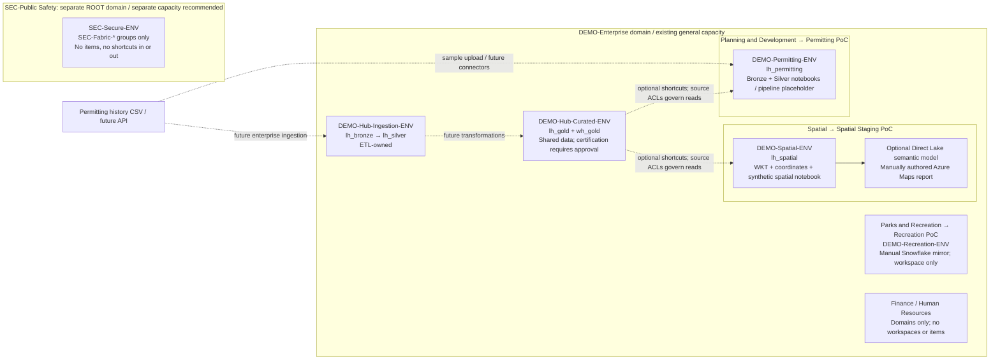

# Generic municipal Fabric data mesh

A repeatable municipal hub-and-spoke demonstration with synthetic permitting fixtures and a licensed public Canadian geospatial example. **All deployed names are generic and configurable.** Terraform manages governance, workspaces, items and group assignments using the official `microsoft/fabric` provider. Existing capacities and existing Entra security groups are looked up by exact display name. No capacity, group or production source-system connection is created.

**Safety boundary:** the isolated workspace has its own root domain, only isolated-group grants, no items and no shortcut routes. This is **logical access separation, not completed network isolation**. Do not load sensitive information until the manual controls at the end are enforced. A shared capacity is a demo convenience, not a security guarantee.

## Architecture



Solid arrows describe the spatial demonstration; dashed arrows are future data movement or opt-in shortcuts. Terraform does not execute notebooks, ingest municipal data, populate the warehouse, certify data or schedule pipelines. The two hub lakehouses separate raw and cleansed data; a separate curated workspace lets BI developers read shared gold without editing it. Spokes own their local transformations and gold outputs.

### Business-area reference

The original municipal scenario maps **permitting/POSSE to Planning & Development** and **recreation/XPLOR to Parks & Recreation**. The official [planning department](https://www.halifax.ca/business/planning-development), [permitting service](https://www.halifax.ca/home-property/building-development-permits/help-using-online-pplc-system) and [recreation registration](https://www.halifax.ca/parks-recreation/programs-activities/recreation-activities/program-registration) confirm those business areas. Validate actual application ownership, POSSE/XPLOR product versions, APIs, licensing and Snowflake availability with the customer; public service pages are not a source-system integration contract. Those product names are not deployed names or connectors in this example.

## Layout and naming

| Path | Purpose |
|---|---|
| `infra\terraform` | Root configuration, pinned providers, outputs and example variables |
| `infra\terraform\modules` | `domain`, `workspace`, `lakehouse`, `role_assignment`, `shortcut` |
| `infra\terraform\definitions` | Empty pipeline and optional map-ready semantic model |
| `infra\terraform\tests` | Mocked, **plan-only** isolation and expansion tests |
| `scripts\bootstrap_onelake.py` | Optional, idempotent OneLake directory REST helper |
| `scripts\tests` | REST behavior, notebook syntax and spatial fixture tests |
| `notebooks` | Bronze history load, Silver MERGE, synthetic spatial showcase and sample CSV |
| `PBI` | Semantic model inventory, BPA and memory diagnostic notebooks; see the [complete usage guide](PBI/README.md) |

Workspace convention: `<Prefix>-<Area>-<Layer?>-<ENV>`. Defaults are `DEMO-Hub-Ingestion-DEV`, `DEMO-Hub-Curated-DEV`, `DEMO-Permitting-DEV`, `DEMO-Spatial-DEV`, `DEMO-Recreation-DEV` and `SEC-Secure-DEV`. Item names such as `lh_bronze` are scoped to a workspace and configured in `item_names`.

Domains are shared across environments, prefixed with `prefix` or `secure_prefix`. The three-level hierarchy comprises ten domains: Enterprise; Planning and Development / Permitting PoC; Parks and Recreation / Recreation PoC; Spatial / Spatial Staging PoC; Finance; Human Resources; and a **separate** Public Safety root. `domains` configures labels/parents; `workspaces` configures display-name components and domain assignments while preserving six stable wiring keys. Prefixed domain names must fit Fabric's 40-character limit.

`environments` defaults to `["DEV"]`; adding `TEST` or `PROD` creates independent workspaces, items and role assignments, not new governance domains. Remove environments only after reviewing the resulting destructive plan. `capacity_name_secure` is the generic name of the isolated-area capacity input; `null` reuses `capacity_name_general`. **Separate capacity recommended.**

Changing the prefix does not change group display names. Override the **complete** `group_role_map` if your pre-created groups use another prefix. Choose unique prefixes to avoid existing domain/workspace name collisions; Terraform does not adopt existing resources by name.

## Role matrix

This table describes the defaults in the single `group_role_map` variable.

| Existing group | Hub ingestion | Hub curated | All three general spokes | Isolated workspace | Domain role |
|---|---|---|---|---|---|
| `DEMO-Fabric-Admins` | Admin | Admin | - | - | Enterprise Admins |
| `DEMO-Fabric-Workspace-Admins` | - | - | Admin | - | General business/PoC Admins |
| `DEMO-Fabric-Data-Engineers` | Contributor | Contributor | Contributor | - | General domains Contributors |
| `DEMO-Fabric-BI-Developers` | - | Viewer | Contributor | - | - |
| `DEMO-Fabric-Viewers` | - | - | Viewer | - | - |
| `SEC-Fabric-Admins` | - | - | - | Admin | Public Safety Admins |
| `SEC-Fabric-Data-Engineers` | - | - | - | Contributor | Public Safety Contributors |
| `SEC-Fabric-BI-Developers` | - | - | - | Contributor | - |
| `SEC-Fabric-Viewers` | - | - | - | Viewer | - |

Domain contributors govern workspace-to-domain assignment; this is not item-write access. Finance/HR receive only governance assignments, not data items. There is one authoritative domain-role set per role and one domain-workspace assignment set per domain across environments; do not manage the same sets from another state.

Entra groups are discovered using `azuread_group` with `security_enabled=true`; duplicate display names must be resolved. Variable validation rejects cross-boundary group grants and secure shortcut targets, but cannot inspect nested group membership or stop a tenant administrator making an out-of-band grant.

### Read-only shortcuts are permission-dependent

Internal OneLake shortcuts **do not have a read-only Terraform property**. [Effective access is the most restrictive combination of shortcut and source permissions](https://learn.microsoft.com/fabric/onelake/onelake-shortcut-security).

Shortcuts default off. First create actual Delta tables in hub gold's `dbo` schema, then grant consumers read-only source access through item sharing/OneLake security as appropriate. General BI developers already have curated Viewer access. General Viewers have **no default hub grant** and need an explicit, reviewed source-table read grant to use shortcuts. ETL engineers and administrators intentionally have hub write privileges and are not read-only consumers; this design does not restrict those owners via a shortcut.

After review, set:

```hcl
enable_shortcuts         = true
shortcut_access_reviewed = true
shortcut_tables = {
  planning = ["dim_date"]
  spatial  = ["dim_date", "dim_service"]
}
```

Those tables must already exist under hub `Tables/dbo/`. Destination paths are the spoke's `Tables/dbo/<table>`; do not reuse a local table name. The acknowledgement is **not an ACL**. No source or destination in this shortcut graph can be the isolated workspace.

## Prerequisites

1. Terraform 1.9+, Azure CLI, Python 3.10+ for the optional REST helper, and access to a **disposable demo tenant**. Use only synthetic or appropriately licensed public data, never sensitive operational records.
2. Fabric administrator rights for creating domains. For a service principal, tenant administration must authorize the relevant admin APIs and domain operations; merely granting a workspace role is insufficient.
3. Fabric tenant setting **Service principals can use Fabric APIs** enabled for the deployment identity's security group when using a service principal. Enable the corresponding read-only/update admin API service-principal settings as required for domain administration. The domain resource documentation warns against configuring admin-consent-required Fabric API permissions on that application; follow the linked provider guidance.
4. The nine security groups above must already exist, with reviewed memberships and no general-estate groups nested inside isolated groups. The AzureAD provider also needs permission to read these groups; for app-only lookup, grant an appropriate Microsoft Graph permission such as `Group.Read.All` with admin consent. Do not confuse Graph permissions with the Fabric admin API restriction.
5. Active, existing Fabric capacities with sufficient headroom. The operator needs capacity admin or Contributor/assignment rights, permission to list the target capacity, and permission to create workspaces. This example does not bypass capacity-state validation or create/resize capacities.
6. To deploy and use the optional model, permission to create semantic models, SQL endpoint/OneLake read access and appropriate Power BI licenses. Small capacities such as F4 do not provide F64's free-user Power BI consumption entitlement.
7. Tenant approval for Azure Maps visuals and any associated external processing; review map-data residency and licensing. A report authoring tool such as Power BI Desktop or the Fabric web editor is required for the manual report step.

The workspace creator automatically retains an individual/application Admin assignment. Terraform adds the listed groups but does not remove that bootstrap assignment or other out-of-band grants. For genuine sensitive-data deployment, use an approved isolated identity/state, review/remove inappropriate creator access after isolated admins take ownership, and preserve an authorized destruction/maintenance path. This shared demo state must not be used as the production isolation boundary.

### Authentication

Interactive:

```powershell
az login
# Select the intended demo subscription/tenant using your normal CLI process.
# use_cli_auth = true (default)
```

If interactive Fabric API consent is blocked, follow the provider's [user authentication guide](https://github.com/microsoft/terraform-provider-fabric/blob/v1.15.0/docs/guides/auth_app_reg_user.md); an Azure CLI subscription login alone does not grant Fabric rights.

For service-principal operation set `use_cli_auth = false` in your local tfvars. Populate these environment variables **from your secret store**, never from committed scripts or tfvars:

| Consumer | Environment variables |
|---|---|
| Fabric provider and REST helper | `FABRIC_TENANT_ID`, `FABRIC_CLIENT_ID`, `FABRIC_CLIENT_SECRET` |
| AzureAD provider | `ARM_TENANT_ID`, `ARM_CLIENT_ID`, `ARM_CLIENT_SECRET` |

Use the same intended tenant/identity for both providers. The REST helper also accepts a complete `AZURE_TENANT_ID` / `AZURE_CLIENT_ID` / `AZURE_CLIENT_SECRET` set; otherwise it explicitly uses Azure CLI. It requests a **storage** token for OneLake, not a Fabric control-plane token. No credential, tenant ID or real object ID is embedded in the code.

## Run safely

Commands are PowerShell from the repository root. Start with one environment; no command below creates or resizes a capacity.

```powershell
Copy-Item infra\terraform\terraform.tfvars.example infra\terraform\terraform.tfvars
# Edit the existing capacity name and full group map to match your demo tenant.
terraform -chdir=infra\terraform init
terraform -chdir=infra\terraform fmt -check -recursive
terraform -chdir=infra\terraform validate
terraform -chdir=infra\terraform test
terraform -chdir=infra\terraform plan -input=false -out=demo.tfplan
```

**Stop here and review the plan.** For the default DEV configuration the mocked plan contains **72 managed resources**: ten domains, twenty domain-role sets, five domain-workspace sets, six workspaces, twenty-one workspace-role grants, five lakehouses, one warehouse, three notebooks and one empty pipeline. Capacity and group lookups are data sources, not managed resources. Optional shortcuts/models add resources only when enabled.

Only an operator who approves the reviewed plan should run:

```powershell
terraform -chdir=infra\terraform apply demo.tfplan
terraform -chdir=infra\terraform output workspaces
terraform -chdir=infra\terraform output -json | Set-Content -Encoding utf8 demo-outputs.json
```

The full mesh was not applied. The separately authorized Canadian geospatial deployment below uses its own state and an existing capacity. State, tfvars, plans, outputs and secrets are ignored. Keep `.terraform.lock.hcl` in version control. The local backend is convenient only for a single-user demo; use an encrypted, access-controlled remote backend with locking before collaboration. Never commit state or upload it to a public service.

### Optional directories and history demo

The provider has no standalone resource for arbitrary **OneLake Files directories**. Workspace `fabric_folder` resources, where available, are organizational folders for Fabric items, not these data paths. The helper uses the documented OneLake ADLS-compatible **data-plane REST API**, not a fabricated Fabric control-plane endpoint. A generic Fabric REST item call cannot create these directories.

```powershell
python -m pip install -r scripts\requirements.txt
python scripts\bootstrap_onelake.py --outputs demo-outputs.json --dry-run
# After reviewing the exact paths, remove --dry-run.
python scripts\bootstrap_onelake.py --outputs demo-outputs.json
```

The helper validates inputs, never targets a secure workspace from the generated manifest, checks for existing directories, retries transient throttling and fails closed on access denial/file collisions. `--dry-run` performs **no authentication, network calls or writes**; it does not claim that remote directories exist. `--environment DEV` limits execution. Treat the output manifest as trusted deployment input; arbitrary edited IDs are not an authorization boundary.

Upload `notebooks\sample-data\history.csv` into `lh_permitting` at `Files/bronze/permits/history/history.csv`. The API staging folder is `Files/bronze/permits/api`. Run `nb_history_load`, then `nb_silver_merge`, with their Terraform-bound default lakehouse.

The Bronze notebook reads `Files/bronze/permits/history/*.csv`, adds `_source_file`/`_load_ts` and **replaces the full** `dbo.bronze_permits` snapshot. Silver deduplicates on `permit_id`, protects newer `updated_at` values and advances `dbo.etl_watermarks` only after a successful Delta MERGE into `dbo.silver_permits`. Replaying the sample produces three current permits, including two approved permits. The ingestion-time watermark handles late business events; inclusive cursor replay supports recovery after a merge succeeds but watermark persistence fails.

This is a single-writer, full-history demonstration, not production exactly-once CDC. Equal event-time conflicts, tombstones, schema changes, history pruning and overlapping writers need explicit source contracts. The pipeline is empty and unscheduled: connect the notebooks and configure their dependency/retry policies before using it for orchestration.

## Geospatial demonstrations

### Real Canadian open data: standalone deployment

`infra\geospatial` deploys a dedicated `DEMO-Spatial-DEV` workspace on an existing active capacity, without deploying domains, security groups, the full mesh or the secure estate. It owns a schema-enabled `lh_spatial`, `T02 - Engineering` workspace folder, PySpark notebook `nb_canadian_geo` (explicit `ipynb` definition), a Direct Lake semantic model `sm_canadian_geo` and a PBIR report `rpt_canadian_geo`. No capacity is created or resized; only the deploying principal's default workspace Admin access is provisioned.

The notebook uses the City of Vancouver's [Parks](https://opendata.vancouver.ca/explore/dataset/parks/) and [Local Area Boundaries](https://opendata.vancouver.ca/explore/dataset/local-area-boundary/) datasets. **Contains information licensed under the [Open Government Licence - Vancouver](https://opendata.vancouver.ca/pages/licence/).** The licence attribution is included in the notebook, exported GeoJSON, validation manifest and report. This demonstration does not claim municipal endorsement.

At source verification there were 218 public park records and 22 local-area polygons. The notebook paginates the real APIs, saves raw JSON and Bronze Delta snapshots, validates keys/coordinates, performs exact Shapely point-in-polygon matching, and writes `dbo.silver_parks`, `dbo.gold_parks` and `dbo.dim_local_areas`. Park positions are source-provided representative locations, not park boundaries. WKT/GeoJSON use WGS84 longitude, latitude. The source `hectare` values are preserved as actual park areas; distances are Haversine to a documented Vancouver reference point, not road travel distances.

Points outside the planning polygons are retained as **Unassigned by spatial join**, not forced into a fabricated neighbourhood. Missing/invalid coordinates are recorded as rejected records. `Files/geo/validation.json` reconciles source/gold counts, unmatched/rejected records, source modification dates, retrieval time, total hectares and a source hash. The source is not live operational data: retrieval time does not imply the municipality updated its underlying records that day.

```powershell
Copy-Item infra\geospatial\terraform.tfvars.example infra\geospatial\terraform.tfvars
# Set capacity_name to an existing ACTIVE capacity. Leave publish_analytics=false.
terraform -chdir=infra\geospatial init
terraform -chdir=infra\geospatial fmt -check -recursive
terraform -chdir=infra\geospatial validate
terraform -chdir=infra\geospatial plan "-out=deploy.tfplan"
# Review: five dedicated resources/settings, no existing workspace modifications.
terraform -chdir=infra\geospatial apply deploy.tfplan
python -m pip install -r scripts\requirements.txt
python scripts\run_geospatial.py run-notebook
python scripts\run_geospatial.py verify-data
python scripts\run_geospatial.py sync-sql
# Verify dbo.gold_parks and dbo.dim_local_areas in the SQL analytics endpoint.
# Set publish_analytics=true in the local geospatial terraform.tfvars.
terraform -chdir=infra\geospatial plan "-out=analytics.tfplan"
# Review: only the semantic model and report are added.
terraform -chdir=infra\geospatial apply analytics.tfplan
python scripts\run_geospatial.py refresh-model
terraform -chdir=infra\geospatial output report
```

The notebook runner checks capacity and recent/active jobs before submitting work, captures the job ID immediately and monitors that job rather than blindly resubmitting. All runner actions support `--dry-run` without authentication or API calls after Terraform outputs exist. Spark settings pin runtime 1.3, a one-node starter-pool maximum and a five-minute idle timeout for this small demo; they do not resize the capacity or change any other workspace. Shared-capacity Spark jobs can still queue until cores are available. The first notebook cell installs Shapely 2.2.0 with `%pip` because this runtime does not include it; allow outbound access to the package index, or preinstall it in a Fabric Environment in restricted tenants. The local requirements allow the same transformations to be tested outside Spark.

After deliberately updating notebook code, `run-notebook --new-run` allows a fresh run despite a recent completed/failed job; an active job is always reused. Use the explicit `ipynb` definition: a successful import/job alone is not evidence that notebook cells or output data exist. The verification step reads the persisted quality manifest, not just job status.

The runner sends the documented boolean `_inlineInstallationEnabled=true` parameter inside the notebook job's `executionData.parameters` configuration, matching Fabric CLI `job run --config`. API/pipeline notebook runs disable `%pip` by default. It affects this job only, not a tenant setting.

Notebook execution, SQL metadata synchronization and model refresh are operational REST calls, not Terraform-managed jobs. `sync-sql` uses the SQL endpoint `refreshMetadata` API with `recreateTables=false`, then checks every returned table status. It never drops SQL tables.

The report contains an Azure Maps bubble map with explicit longitude/latitude and park area as bubble size, a parks-by-local-area chart, park-count/total-hectares cards and visible licence attribution. The model defines a many-to-one park-to-area relationship and measures for count, hectares, washrooms and average distance. The map groups by unique Park ID and uses visual-level **Average** coordinates, as Azure Maps requires when a Location grouping is present; park names appear in tooltips. Explicit coordinates avoid geocoding labels. `Files/geo/vancouver_local_areas.geojson` is also available for an optional local reference-layer upload; WKT does not automatically render as polygons. The built-in Azure Maps visual requires tenant approval and applicable network access.

**Live verification:** the authorized standalone deployment ran successfully on an existing active F2 capacity. The persisted snapshot contains **218 parks, 22 source polygons, 23 area dimension members including Unassigned, and 1,351.7 hectares**. There are 217 spatially matched parks, one retained unmatched park, zero rejected records and zero orphan relationship keys. All five Delta tables were synchronized and independently checked through the SQL analytics endpoint. The Direct Lake model refresh completed; a service-rendered report PDF was inspected and shows Vancouver park bubbles, the area chart, both KPI cards and licence attribution without visual errors. The final Terraform plan reports **no changes**. The full mesh remains unapplied.

For teardown, run `terraform -chdir=infra\geospatial plan -destroy` and, after review, `terraform -chdir=infra\geospatial destroy`. This removes this demo's data and items, not the existing capacity or training workspace. **Do not run the full mesh state against the same `DEMO-Spatial-DEV` name without first transferring/importing ownership**: the standalone demo and full mesh must not both manage the same workspace/lakehouse. Use a different mesh prefix or explicitly migrate state.

### Optional synthetic spatial sample in the full mesh

1. Run `nb_spatial_showcase` in each desired Spatial workspace. It deterministically writes **12 fictional service sites**, **four rectangular demo zones**, `dbo.gold_spatial_sites`, `dbo.gold_spatial_zones` and `Files/geo/showcase_zones.geojson`. No external download, GIS package, real address or police information is required. The configurable default map centre is near Halifax; the fixtures are not real assets or boundaries.
2. Inspect WKT `POINT`/`POLYGON` text, separate numeric latitude/longitude, site-to-zone assignments, synthetic service-request metrics and great-circle distance to the demo centre. Coordinates use WGS84/EPSG:4326; WKT and GeoJSON use **longitude first**. Rectangular containment uses a half-open grid, not a general polygon engine. Distance uses Haversine in kilometres.
3. Wait until both Delta tables appear in the lakehouse **SQL analytics endpoint**. Set `deploy_spatial_model = true`, run a new plan and have an operator apply it. The model uses Direct Lake over that endpoint and a many-to-one Sites-to-Zones relationship; map categories and basic DAX measures are already defined. If overriding notebook table names, update the semantic definition's entity names too.
4. In semantic model settings, verify/map its connection and authentication, ensure the author and consumers can read the source, and refresh/reframe the model. Credentials and connection bindings are intentionally not embedded in its definition. A fixed-identity connection changes the security model and must be reviewed separately. Fabric runtime/model creation and connection binding require tenant validation.
5. Create a report from `sm_spatial_showcase`. Add an **Azure Maps** visual; bind `Sites[Latitude]` to Latitude, `Sites[Longitude]` to Longitude, `Sites[Site]` to Location, `Sites[Category]` to Legend, and `[Total Requests]` to Size. Set the visual's Latitude and Longitude aggregations to **Average** when Location is present, preserving one coordinate pair per unique site. Add `[Average Distance Km]` and `Zones[Zone Name]` as tooltips and a zone slicer. Do not geocode synthetic labels.
6. Switch the visual between bubble and heat-map layers. Add `[Site Count]`/`[Total Requests]` cards and a requests-by-zone chart. Cross-filtering demonstrates the semantic relationship. WKT strings do **not** automatically become map polygons.
7. For polygon outlines, download `Files/geo/showcase_zones.geojson` from the lakehouse and add it as a local **Azure Maps reference layer** where the authoring surface supports upload. It is a static overlay; dynamic zone colouring requires a supported data-bound layer/join configuration, not just uploading GeoJSON. A private OneLake URL is not an anonymously accessible reference-layer URL. Do not enable public access to OneLake to make a map work.

The synthetic full-mesh report remains manually authored; its model and data are the map-ready foundation. This is **not** a provider limitation: the standalone Canadian example above provisions `fabric_report` using PBIR and has been verified through an actual service render. Tenant approval and appropriate source access remain prerequisites for both examples.

Real spatial data can later come from a licensed municipal open-data catalogue after validating attribution, coordinate reference systems, update cadence and privacy. Do not substitute sensitive or real-time operational data in this demo.

## Cost and teardown

- An F4 capacity is an **existing resource** here; Terraform does not create, resize, start or pause it. Small SKUs may need careful Spark concurrency scheduling. Notebooks and queries consume compute only when executed, but existing active capacity billing continues independently.
- Ordinary OneLake lakehouse/warehouse storage is billed per GB according to region and storage tier. Empty infrastructure is not a promise of zero cost; populated Delta data, logs and retained versions can grow.
- [Mirroring](https://learn.microsoft.com/fabric/mirroring/overview) includes **1 TB of mirrored storage per purchased CU per capacity**, not per workspace. An F4 therefore has up to 4 TB of eligible free mirrored storage under the service terms. Ordinary lakehouse storage is not covered by that allowance. Excess mirrored storage, and storage when capacity is paused, can incur OneLake charges.
- Pausing capacity **stops mirroring replication**; the retained data is not deleted. Snowflake-side compute/egress and Power BI licenses can also cost money. Recreation is only a workspace here: no mirror or Snowflake connection is created.
- Separate isolated capacity improves workload/administrative separation but costs more; it does not automatically implement network isolation or remove tenant-admin privileges.

Before teardown, remove any manually added schedules/connections/mirroring configurations as appropriate and back up anything intentionally retained. Then review and execute:

```powershell
terraform -chdir=infra\terraform plan -destroy -out=destroy.tfplan
# Review: only this state's demo domains, grants, workspaces and items should be removed.
terraform -chdir=infra\terraform destroy
Remove-Item demo-outputs.json -ErrorAction SilentlyContinue
```

Destroying lakehouses/workspaces also removes the helper-created directories, sample data, untracked reports and other items inside them. Fabric retention/recovery rules may delay permanent deletion. Existing capacities and Entra groups remain untouched; source-system connections and externally hosted files are not tracked here. Never destroy a workspace that has been repurposed for real data.

## Validation and verified provider references

Provider documentation was checked **2026-11-09** before writing code. The current Registry version was **1.15.0**, published 2026-11-08, and is pinned exactly. Initialization selected `hashicorp/azuread` 3.10.0 under the 3.x constraint; the lock file records the resolved versions/hashes.

Implemented, real resources: [`fabric_domain`](https://github.com/microsoft/terraform-provider-fabric/blob/v1.15.0/docs/resources/domain.md), [`fabric_domain_role_assignments`](https://github.com/microsoft/terraform-provider-fabric/blob/v1.15.0/docs/resources/domain_role_assignments.md), [`fabric_domain_workspace_assignments`](https://github.com/microsoft/terraform-provider-fabric/blob/v1.15.0/docs/resources/domain_workspace_assignments.md), [`fabric_workspace`](https://github.com/microsoft/terraform-provider-fabric/blob/v1.15.0/docs/resources/workspace.md), [`fabric_workspace_role_assignment`](https://github.com/microsoft/terraform-provider-fabric/blob/v1.15.0/docs/resources/workspace_role_assignment.md), [`fabric_lakehouse`](https://github.com/microsoft/terraform-provider-fabric/blob/v1.15.0/docs/resources/lakehouse.md), [`fabric_warehouse`](https://github.com/microsoft/terraform-provider-fabric/blob/v1.15.0/docs/resources/warehouse.md), [`fabric_shortcut`](https://github.com/microsoft/terraform-provider-fabric/blob/v1.15.0/docs/resources/shortcut.md), [`fabric_notebook`](https://github.com/microsoft/terraform-provider-fabric/blob/v1.15.0/docs/resources/notebook.md), [`fabric_data_pipeline`](https://github.com/microsoft/terraform-provider-fabric/blob/v1.15.0/docs/resources/data_pipeline.md) and [`fabric_semantic_model`](https://github.com/microsoft/terraform-provider-fabric/blob/v1.15.0/docs/resources/semantic_model.md). Capacity lookup uses the documented [`fabric_capacity` data source](https://github.com/microsoft/terraform-provider-fabric/blob/v1.15.0/docs/data-sources/capacity.md), not a guessed plural/singular resource.

`fabric_domain_workspace_assignments` is documented as preview in this release, so `preview=true` is explicit. Review that dependency before production use.

```powershell
terraform -chdir=infra\terraform fmt -check -recursive
terraform -chdir=infra\terraform validate
terraform -chdir=infra\terraform test
python -m unittest discover -s scripts\tests -v
```

Both Terraform roots pass formatting and provider-schema validation; five mocked architecture plans and **20 Python tests** pass. Mock IDs are synthetic fixtures, never real tenant IDs. The full mesh's live read-only plan remains **blocked** by the placeholder `F4 capacity name` and nine example groups, so that mesh was not applied. The separately authorized Canadian root was deployed and verified against real Spark, Delta, SQL, semantic-model refresh and Azure Maps report rendering as described above; its final live plan has zero changes.

## Provider gaps and required manual controls

| Capability | Implementation / remaining action |
|---|---|
| Arbitrary OneLake `Files` directories | No standalone provider resource; `scripts\bootstrap_onelake.py` uses OneLake ADLS-compatible REST with idempotent checks and `--dry-run`. No Terraform `local-exec` side effects. |
| Read-only internal shortcut switch | Not supported: enforce reviewed source permissions/OneLake security; no script can safely invent such a flag. ETL owners retain their intentional source write privileges. |
| Snowflake mirrored database | Intentionally workspace-only, per the architecture. Configure mirroring, Snowflake credentials, tables, replication and capacity requirements manually after approval; do not interpret this as an exhaustive provider support claim. |
| Isolated workspace private link / inbound protection | Required **before sensitive data**. Provision/approve the workspace private endpoint, private DNS and allowed network path; block public inbound access and verify from allowed/denied clients. Provider 1.15 has network policy/firewall resources, but endpoint approvals and tenant/network choices are intentionally not auto-applied by this demo. |
| Outbound access protection (OAP) | Enable on the isolated workspace and explicitly allow only required destinations; verify workload/region/SKU support, approved endpoints and denial tests. A separate capacity is not OAP. Relevant workspace network/outbound policy resources exist but are not implicitly configured here. |
| Sensitivity labels | Publish appropriate Purview labels and apply required labels/label policies to isolated items when created; review inheritance, export and sharing behavior. Labels are not a replacement for authorization. No sensitive items are deployed. |
| OneLake security roles | Configure and test least-privilege table/folder roles, default-reader behavior, consumers' hub source access and isolated data access. Provider lakehouse definitions can carry access-role metadata; this demo leaves policy-specific roles to security review instead of claiming unsupported provider functionality. |
| Shared-data certification | Have authorized owners review lineage, quality, stewardship and endorsement, then certify eligible curated items manually. Terraform's existence of a Gold lakehouse does not certify anything. |
| Secure identity and actual isolation | Review nested Entra membership, creator Admin access, sharing, existing grants, tenant-admin powers, production state separation and separate-capacity assignment. Deny all shortcuts in/out operationally as well as in this code; Terraform validation alone is not a tenant-wide policy. |
| Semantic model connection / Maps report | Run the synthetic notebook, wait for SQL discovery, opt in to model deployment, bind approved credentials and author/test the Azure Maps report. Neither connection readiness nor map rendering is proven by `terraform validate`. |

`bootstrap_onelake.py` is deliberately limited to the unsupported directory operation. `run_geospatial.py` handles operational notebook jobs, SQL metadata synchronization and model refresh through documented REST APIs; these are not declarative Terraform resources. Other rows are explicit service/security approvals or intentionally manual architecture steps, not invented APIs or claims of completed production hard isolation.
